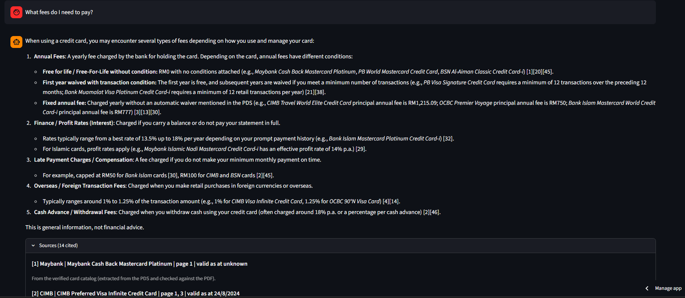
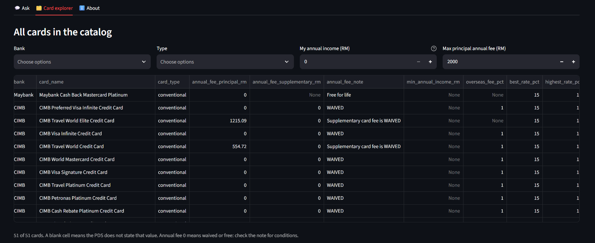
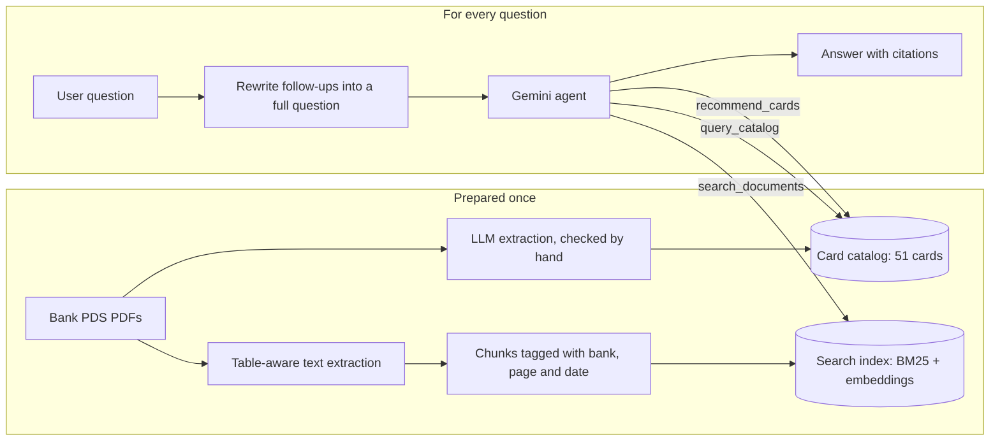

   > **Status:** frozen at v3.2 (portfolio release). Active development continues in [KadKaki](https://github.com/Pang512/kadkaki).
# 💳 Malaysian Credit Card Assistant

An AI chatbot that helps first-time cardholders in Malaysia understand and compare credit cards, including **Islamic credit cards (Credit Card-i)**. It answers only from the banks' official **Product Disclosure Sheets (PDS)**, cites the document and page for every fact, and says so when the documents don't cover something.

**▶ Try it: [malaysia-credit-card-assistant.streamlit.app](https://malaysia-credit-card-assistant.streamlit.app/)**



---

## The problem

Credit card fees, interest tiers and waiver conditions are spread across long PDF documents, and every bank words them differently. A fresh graduate who wants to know "which card can I get on RM3,200 a month, and what will it cost me?" has to read and compare many of them. General chatbots answer quickly but can make up fees or perks. This assistant answers from the official documents only, and shows its sources.

## What it can do

- **Answer questions** about fees, interest or profit rates, late charges, eligibility and Shariah terms (e.g. Ta'widh, Tawarruq)
- **Compare and list cards** across 8 banks: Maybank, Maybank Islamic, CIMB, OCBC, Public Bank, Bank Islam, Bank Muamalat, BSN
- **Recommend a shortlist** for a stated priority (lowest cost, everyday spending, travel, low interest), with the reasons and the trade-offs
- **Ask a follow-up question** when it needs your priority, and understand follow-ups like "which of the two is cheaper?"
- **Card explorer:** filter all 51 cards by bank, type, income and annual fee



## How it works



1. **Reading the documents.** PDFs are parsed with table detection, so fee tables keep their rows and columns. The text is split into chunks, each tagged with its bank, product, page and "valid as at" date.
2. **Searching.** A question is matched by keywords (BM25) and by meaning (BGE embeddings in FAISS). The two rankings are merged with Reciprocal Rank Fusion.
3. **The card catalog.** Fees, income limits and rates for all 51 cards were extracted with Gemini into a fixed schema, then checked against the PDFs.
4. **The agent.** Gemini decides which tool to use. Filtering, sorting and ranking happen in Python, not in the model, so the numbers are exact. The model only explains the results and must cite a source for every fact.
5. **Guardrails in code.** It won't recommend before you give a priority, caps citations, and computes the "why ranked lower" reasons itself.

## Results

Measured on a hand-written test set of **50 questions** (46 answerable, 4 deliberately unanswerable). All rows are scored by the same LLM judge, so they are comparable; answers were also reviewed by hand.

| Version | Correct | Correct or partial | Faithful to sources | False refusals |
|---|---|---|---|---|
| Baseline RAG | 73.9% | 82.6% | 100% | 15.2% |
| + improved prompt | 82.6% | 91.3% | 100% | 4.3% |
| + hybrid search | 82.6% | 97.8% | 98% | 0% |
| + table-aware chunks | 87.0% | 95.7% | 100% | 0% |
| + agent with card catalog | 87.0% | 100% | 94% | 0% |
| **Final agent (run 1 / run 2)** | **82.6% / 89.1%** | **100% / 100%** | **90% / 94%** | **0% / 0%** |

- **After manual review**, the final runs score 80.4% / 89.1% correct and 94% / 98% faithful. The judge had missed some fee details the agent was given, so it marked a few correct answers as unfaithful.
- **Citation accuracy** (a cited source contains the expected page): 95 to 100% in every version, and 100% for all agent versions.
- **The final version was run twice.** The same code scored 83% and 89% fully correct, because the model doesn't answer identically every time. The 100% "correct or partial" and 0% false refusals held in both runs.
- **Retrieval** (does the right page appear in the top 5 results?):

  | Chunking | Search | Hit@5 | MRR |
  |---|---|---|---|
  | Fixed-size | hybrid | 97.8% | 0.85 |
  | By document structure | hybrid | 100% | 0.93 |
  | By structure, table-aware (used) | hybrid | 97.8% | 0.92 |

  Table-aware chunks retrieve slightly worse but produce more correct answers, because fee tables arrive intact. A cross-encoder reranker was also tested and dropped: no accuracy gain at about 3x the latency.
- **Conversations:** a multi-turn test suite (8 scenarios, 18 turns, 48 automatic checks) passes 47 of 48 checks.

All results are in [`eval/results/`](eval/results/).

## Limitations

- Covers **8 banks only** (no Hong Leong, RHB or AmBank yet). Some documents date from 2024.
- PDS documents rarely state **cashback rates, rewards, lounge access or minimum income**, so the assistant can't compare those.
- Runs on Gemini's **free tier**: answers can take 3 to 30 seconds, and there's a daily question limit.
- The test set is small (46 answerable questions), and results vary between runs.
- Known occasional issues: a missed feature (e.g. cashback mentions), or a yes/no answer that opens with the wrong word.
- **This is general information, not financial advice.** Always confirm with the bank.

## Run it yourself

You need Python 3.11 or newer and a free Gemini API key from [Google AI Studio](https://aistudio.google.com/).

```bash
git clone https://github.com/Pang512/malaysia-credit-card-rag.git
cd malaysia-credit-card-rag
python -m venv .venv
.venv\Scripts\activate          # Windows  (macOS/Linux: source .venv/bin/activate)
pip install -r requirements.txt
```

Create a file named `.env` containing `GOOGLE_API_KEY=your-key`. Then build the search index and start the app:

```bash
python src/download.py      # downloads the PDS files listed in data/sources.yaml
python src/ingest.py        # extracts text and creates the chunks
python src/build_index.py   # builds the search index
streamlit run app/app.py
```

The Public Bank PDS has to be downloaded by hand from its link in `data/sources.yaml`. The card catalog is already included.

**To re-run the evaluation:** `python src/eval_retrieval.py` (retrieval), then `python src/run_answers.py --tag mytest --agent`, `python src/judge_answers.py --tag mytest` and `python src/compare_runs.py baseline mytest` (answers), and `python src/run_conversations.py --tag mytest` (conversations).

## Project structure

```
app/app.py            Streamlit web app
src/                  ingestion, chunking, search, catalog, agent and evaluation scripts
data/sources.yaml     the official document links (the PDFs themselves are not included)
data/catalog/         the verified card catalog
eval/                 test questions, conversation tests and all results
config.yaml           models and settings
```

## About the data

The bank documents are not included in this repository. `data/sources.yaml` lists each document's official link and date. The documents were used for a personal, non-commercial portfolio project.

Built by [Pang512](https://github.com/Pang512) with AI-assisted coding. Design decisions, data checks and evaluation reviews by the author.
